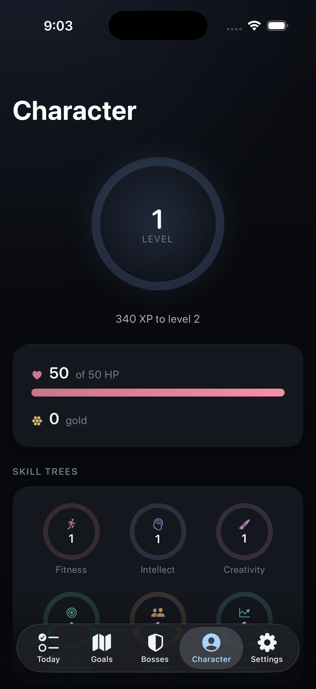
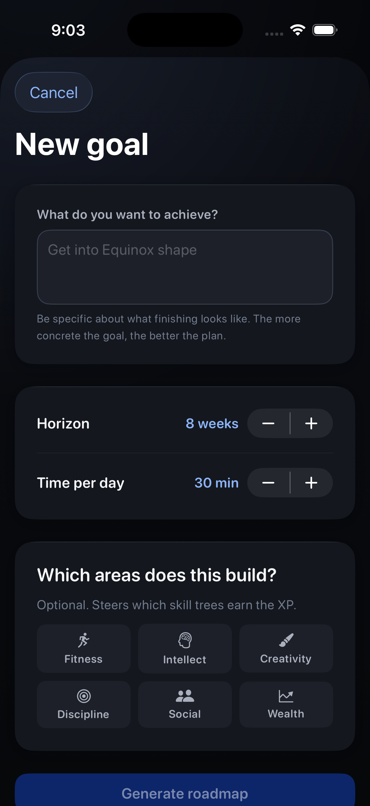
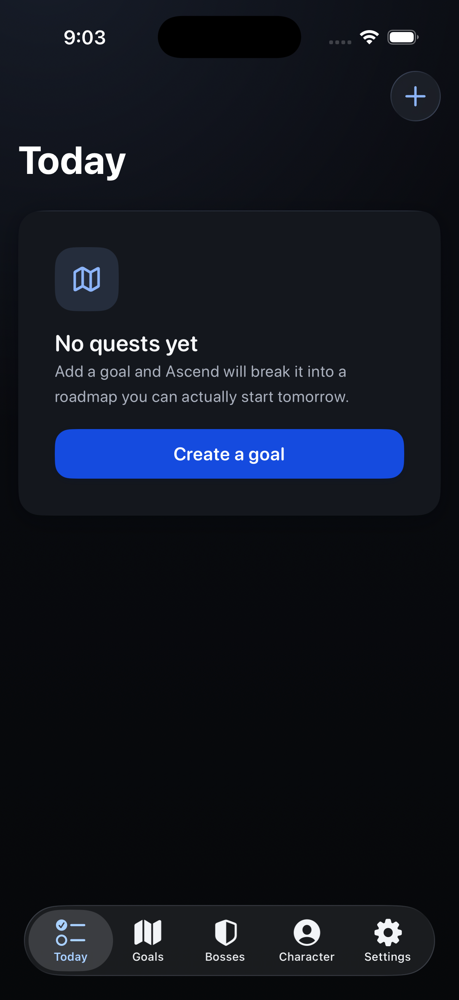

# Ascend

[](https://github.com/luca-fogel/ascend/actions/workflows/ci.yml)

A gamified goal tracker that turns an ambition into a roadmap, then pays you in XP for walking it.

A native **iOS** app in Swift and SwiftUI. Name something you want — *"get into Equinox shape"*,
*"learn SwiftUI well enough to ship an app"* — and Apple Intelligence breaks it into ordered
milestones and daily steps on your phone. Completing them earns XP in one of six skill trees,
builds streaks, and wears down a named boss. Missing them costs HP. Everything runs on device:
no account, no server, no API key.



> **Status: built and working, not released.** It is not on the App Store, there are no users,
> and there are no download numbers to quote. It runs on my phone and it will run on yours in
> about two minutes.

> [!NOTE]
> AI planning needs **iOS 26 and an Apple Intelligence-capable device** (iPhone 15 Pro or newer).
> On anything else — or with Apple Intelligence switched off, or still downloading — the app stays
> fully usable and roadmaps come from a deterministic template planner. That fallback ships; it
> is not a stub.


> **Identity.** The GitHub repository lives under `luca-fogel`. The iOS bundle identifier remains `com.foggylulu.Ascend` (historical handle). Bundle IDs are not renamed here; only public GitHub URLs are canonicalized to `luca-fogel`.


It began as the obvious mash-up: Goalz's AI goal decomposition with Habitica's RPG progression.
The interesting problems turned out to be somewhere else entirely — **how do you make a small
on-device model produce a plan that is not generic, and how do you know whether a change to the
prompt helped?** Both are answered in the repository rather than asserted.

## What it does differently

### Roadmaps are generated in two stages, and only the tier you are on is filled

A twelve-week plan does not fit in the on-device model's context window, and
`GenerationError.exceededContextWindowSize` is a real outcome rather than a hint. So generation
is split — and the second stage is lazy, because six sequential on-device calls is 30–60 seconds
of spinner before anything is usable:

```
  "get into Equinox shape", 8 weeks, 45 min/day
                    │
                    ▼
        ┌───────────────────────┐
        │ stage 1: the tiers    │   one call, ~5s, fresh session
        │ 3–7 milestones        │
        └───────────┬───────────┘
                    │
                    ▼
        ┌───────────────────────┐
        │ stage 2: tier 1 only  │   one call, ~5s, fresh session
        │ 3–8 daily steps       │
        └───────────┬───────────┘
                    │
                    ▼
            you approve it ──────►  written to SwiftData
                    │
                    ▼
        tier 2 is written the first time you open it,
        after tier 1 is complete and unlocks it
```

Each stage gets a **fresh `LanguageModelSession`**, which is subtler than it looks: a session
accumulates its transcript, so reusing one across six per-milestone calls grows the context every
time and hits the window *sooner* than a single-shot prompt would — the exact opposite of the
reason for splitting.

Stage two also receives the rest of the plan. Without that, a tier is detailed in isolation and
the model re-invents earlier tiers almost verbatim: a songwriting plan produced *"Write a song /
Record a song / Upload song"* in tier one and again, nearly word for word, in tier three.

### "The roadmaps feel generic" was turned into a number

That complaint is unfalsifiable as stated, so `ascend-eval` runs the real prompts against a fixed
set of goals and scores the output — filler phrases, concreteness (does a step name an amount?),
whether a step merely restates the goal, and difficulty/cadence variety.

**Mean score went from 53/100 to 81/100**, measured over 12 runs rather than one. The harness
said precisely what was wrong, which is the point:

| Before | After |
|---|---|
| "Draft lyrics", "Pick a tune", "Record a song" — 3.3 words, no quantities | "Read 20 pages of the SwiftUI guide", "Write 25 lines of a list view" |
| Milestones counted: *one song → two songs → three songs* | Milestones progress by capability |
| Tier 3 repeated tier 1 | Each tier sees what came before it |
| "research", "learn the basics", "stay motivated" | Filler phrases named and banned |

Two things that went wrong along the way are recorded in
[docs/ENGINEERING-NOTES.md](docs/ENGINEERING-NOTES.md), because both are the kind of mistake that
looks like a model problem and is not: an example leaked out of a `@Guide` into unrelated output,
and the run-to-run variance was initially wider than the changes being tested.

### The design system is data, so its accessibility is a test

The palette lives in `AscendDomain/Design` as plain `HSL` values, not colour literals in view
files. That is what lets `PaletteContrastTests` sweep every text-on-surface pairing against WCAG
AA — and it **failed the day it was written**, on three real pairings. White on the accent fill
measured 4.25:1 against a 4.5:1 floor; gold could not carry white *or* black text at any single
shade. The fill shade is now searched by measurement rather than assumed, so a new accent colour
cannot ship with unreadable text on it.

The provenance of every token — spacing ratios, the type scale, two-part shadows, tap targets — is
in [docs/DESIGN.md](docs/DESIGN.md).

<p align="center">
  
  
</p>

<p align="center">
  
</p>

The icon is generated too — `tools/make-icon.sh` draws it from the same `Palette` the app uses, so
it cannot drift from the interface it represents. It is the progress ring from the character
screen, opened at the top with a chevron rising through the gap, and it was sized for 40pt rather
than 1024. Details in [docs/DESIGN.md](docs/DESIGN.md).

## Architecture

```
Ascend  (app target, SwiftUI only — no game maths, no model calls)
  └── AscendCore  (local SwiftPM package, cannot import SwiftUI)
        ├── AscendDomain        Foundation only — progression maths, design tokens, DTOs, protocols
        ├── AscendPersistence   + SwiftData — 8 @Model classes, GameManager
        └── AscendIntelligence  + FoundationModels — on-device planning, output scoring
```

The dependency arrows are the design. `AscendIntelligence` depends on `AscendDomain` and **not**
on `AscendPersistence`: the generator emits plain DTOs and a `RoadmapImporter` on the persistence
side does the writing, so the AI layer physically cannot reach the store. `GameManager` returns a
`CompletionOutcome` describing what happened and the views animate from it — no view recomputes
XP or knows the progression curve.

Because none of that needs a simulator or an eligible device, the whole engine — progression
curves, damage, streaks, day rollover, exact undo, the palette — runs in **169 tests** in about
half a second.

## Requirements

iOS 26. Xcode 26, Swift 6.3. AI planning additionally needs an Apple Intelligence-capable device;
everything else works without one.

## Building

```sh
xcodegen generate     # Ascend.xcodeproj is generated and gitignored
open Ascend.xcodeproj
```

To run on a device, create `Local.xcconfig` next to `Signing.xcconfig` containing
`DEVELOPMENT_TEAM = YOURTEAMID`. Simulator builds need no signing.

Debug builds take `-tab today|goals|bosses|character|settings` and `-sheet goal|habit`, so any
screen can be screenshotted without driving the UI.

## Checks

```sh
tools/check.sh
```

Runs the test suite, verifies the count quoted above, builds the app for the simulator, and
enforces the architecture guards — no networking or credentials anywhere, no UI framework inside
`AscendCore`, `AscendDomain` Foundation-only, `AscendIntelligence` never importing the store,
`FoundationModels` confined to one layer, and no type named `Task`. All seven guards have been
negative-tested: each one fails when its rule is deliberately broken.

## Credit

The design system was built by working through two books. The reasoning is cited at the point of
use with page numbers rather than summarised:

- *Refactoring UI* — Adam Wathan & Steve Schoger
- *UI Design Principles* — Michael Filipiuk

Neither book is included in this repository.

## Licence

GPL-3.0. See [LICENSE](LICENSE).
